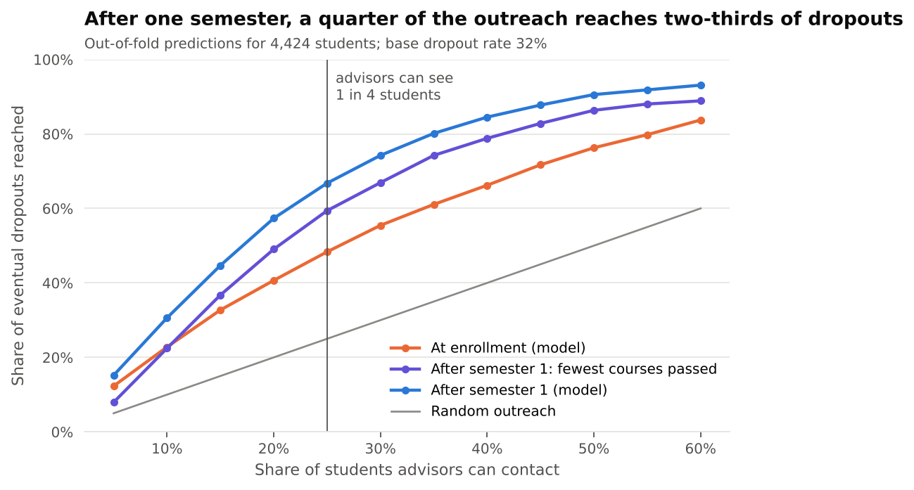
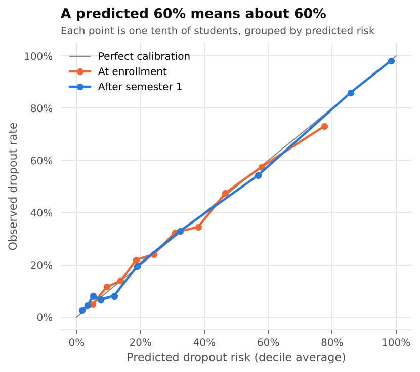
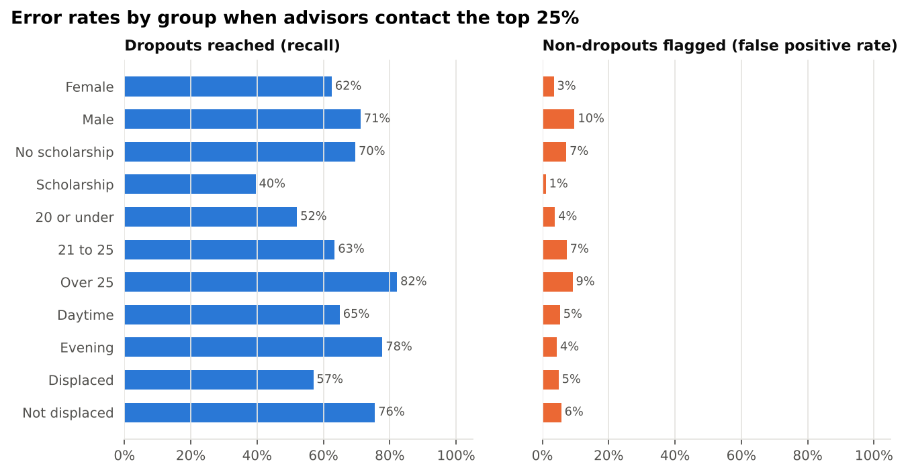

# Student Success Predictor

An early-warning model for university dropout, built around the question an advising office actually faces: **advisors can only contact so many students, so who should they contact, and when?**

4,424 students across 17 degree programs at a Portuguese higher-education institution; 32% dropped out ([Realinho et al., 2022](https://doi.org/10.3390/data7110146)).

## Results

Every number below comes from out-of-fold predictions: each student is scored by a model that never saw them.

| When the list is made | Model | ROC AUC | PR AUC | Dropouts reached if advisors contact 25% of students | Precision |
|---|---|---|---|---|---|
| At enrollment | Logistic regression | 0.77 | 0.62 | 48% (687 of 1,421) | 62% |
| After semester 1 | One-line rule: fewest courses passed | 0.84 | 0.68 | 59% (844) | 76% |
| After semester 1 | Logistic regression | **0.90** | **0.86** | **67% (949)** | **86%** |
| After semester 1, without finance flags | Logistic regression | 0.88 | 0.83 | 64% | 82% |
| Random outreach | | | | 25% | 32% |



**1. Timing matters more than the algorithm.** Gradient boosting (LightGBM) ties logistic regression at both decision points (PR AUC 0.625 vs 0.617 at enrollment, 0.863 vs 0.861 after semester 1), so the interpretable model is the one used. Waiting one semester for grades takes outreach from 48% to 67% of eventual dropouts.

**2. The model earns its place over a simple rule.** Ranking students by how few first-semester courses they passed is a reasonable thing for an advisor to do by hand. The model reaches 105 more of the students who later drop out, with 10 points more precision, for the same number of conversations.

**3. Risk scores can be read literally.** Students given a 60% risk dropped out about 60% of the time, at both decision points.



**4. Equal calibration, unequal recall.** Within every group the average predicted risk matches the observed dropout rate to within about one point. But with one cutoff for everyone, the share of each group's dropouts that gets flagged differs:



| Group | Dropout rate | Dropouts reached | Non-dropouts flagged |
|---|---|---|---|
| Women / men | 25% / 45% | 62% / 71% | 3% / 10% |
| Scholarship / none | 12% / 39% | 40% / 70% | 1% / 7% |
| Age 20 or under / over 25 | 21% / 56% | 52% / 82% | 4% / 9% |

This is the expected result when groups have different base rates: a score cannot be calibrated within groups and also give every group the same recall ([Kleinberg et al., 2016](https://arxiv.org/abs/1609.05807)). Equalizing recall would mean a lower cutoff for some groups. That is a policy choice for the institution, not a modeling one; the audit is here so it can be made deliberately.

**5. Some flagged students are already gone.** 21% of the dropouts flagged after semester 1 sat no exams that semester. For them the semester-1 list arrives late, which is the case for also running the enrollment model.

**6. Scholarship holders drop out far less, and most of the gap survives adjustment.** 12.2% vs 38.7%. Weighting by everything known at enrollment (inverse probability weighting) narrows the gap from 26.5 to 19.9 points (95% CI 16.3 to 23.6). This is an observational comparison: prior grades are not in this version of the data, and an unmeasured factor would need to be associated with both scholarship and dropout by a risk ratio of at least 3.5 to explain the gap away (E-value).

## Recommendation

1. **At enrollment:** light-touch outreach (an email, an orientation check-in) to the highest-risk quarter. It reaches about half of eventual dropouts before any grades exist.
2. **After semester 1:** advisor meetings for the top 25% by the semester-1 model. Historically, 86% of students ranked that high went on to drop out.
3. **Review the recall gaps** for younger students and scholarship holders before deployment, and decide whether to adjust cutoffs.

## What drives the semester-1 model

Permutation importance (drop in PR AUC when a feature is shuffled, held-out 30%): courses passed in semester 1 dominates (0.30), then tuition fees being up to date (0.08), courses enrolled (0.05) and degree program (0.03). Economic conditions at enrollment and family background add a little.

## Limitations

- **Timing of the finance flags.** The data doesn't say when "tuition fees up to date" and "debtor" were recorded. If after the fact, they partly encode the outcome. The model without them still reaches 64% of dropouts, so the conclusions hold either way.
- **One institution, one period** (2008 to 2019 cohorts). Re-check calibration before using it anywhere else.
- **"Still enrolled" counts as not dropping out.** 794 students were still enrolled at the end of the normal program length; some will drop out later.
- This version of the dataset lacks the admission-grade and prior-qualification-grade columns in the later UCI release.

## Reproduce

```bash
pip install -e ".[dev]"
pytest                                   # 5 tests
python experiments/run_analysis.py       # ~30 s; writes results/ and figures/
```

The loader downloads the data from UCI and falls back to a public GitHub copy of the Kaggle release.

```
src/earlyflag/
  data.py     loading, column cleanup, which features exist at each decision point
  model.py    logistic and LightGBM pipelines, out-of-fold predictions
  audit.py    capacity curve, calibration, per-group error rates
  causal.py   inverse probability weighting with bootstrap CI, E-value
experiments/run_analysis.py
results/analysis.json    every number in this README
```

## Data

Realinho, V., Machado, J., Baptista, L., & Martins, M. V. (2022). Predicting Student Dropout and Academic Success. *Data*, 7(11), 146. CC BY 4.0.
